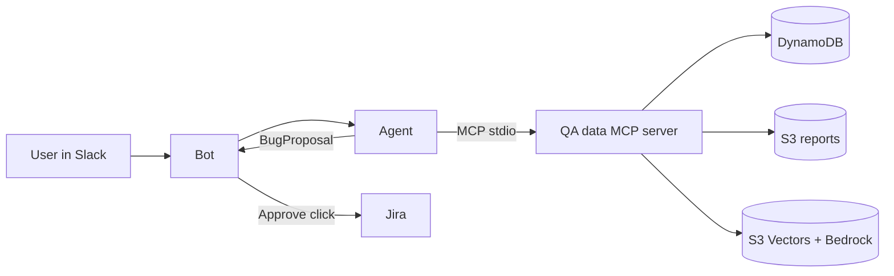

# NN · <Use case> with <Framework>

`🟡 Intermediate` · `react` `mcp` `structured-output` `human-in-the-loop`

> One sentence: what this agent does and what's different about this implementation.

## Problem
What a user asks, what goes wrong today, and what a good answer looks like. Link the shared use case if it's the QA-triage one.

## Pattern
Which agent pattern and why (ReAct loop, workflow graph, supervisor + workers, …). What the model decides vs what code decides.

## Architecture


## Run
```bash
make setup          # .venv for this project
make test           # offline: no keys, no AWS
make run            # needs .env (see root .env.example) and the MCP server's .venv
make eval           # shared eval cases through adapter.py
```

Files: `agent.py` (the agent), `adapter.py` (contract adapter for evals), `bot.py` (Slack interface), `tests/`.

## Eval results
<!-- Copy this project's row from docs/comparison.md after `make eval`. -->
| Pass rate | Category acc. | KB match acc. | Median latency | Cost / run | Model |
|---|---|---|---|---|---|
| – | – | – | – | – | – |

## Trade-offs
- What this framework made easy.
- What it made hard or hid.
- What I'd change for production (limits, observability, deployment).
