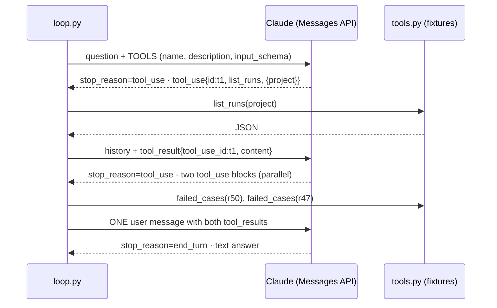

# 01 · Tool use basics: the agent loop by hand

`🟢 Foundations` · `tool-use`

> About 40 lines of Python that do what every agent framework in this repo automates: send tools to the model, run the calls it asks for, send the results back, and repeat until it answers.

## Problem
"Agent" frameworks hide one simple mechanism. Until you've written it yourself, it's hard to see what LangGraph, the Claude Agent SDK or Strands are actually doing for you, or to debug them when a tool call goes wrong.

## Pattern
**A manual tool-use loop** over the Messages API. The two tools read the shared synthetic fixtures, so there is no AWS and no database. The model only ever *asks* for a tool; this code runs it.

```
messages = [question]
loop:
    response = model(messages, tools)
    stop_reason == "end_turn"  → answer, done
    stop_reason == "tool_use"  → run each tool_use block,
                                 append ONE user message with all tool_result blocks
                                 (tool_result.tool_use_id = tool_use.id)
```

## Architecture


| File | Role |
|---|---|
| `tools.py` | tool definitions (what the model sees) and implementations (what runs); errors become `is_error: true` |
| `loop.py` | the loop, with a `max_steps` guard and token counting; `--show-messages` prints every block |

## Run
```bash
make test                                    # offline: scripted fake client using real SDK types
make run Q="Why did run r50 fail?"           # live; needs ANTHROPIC_API_KEY (root .env)
```

Things to try with `--show-messages`:
- Ask about `r99`: the tool returns `is_error: true` and the model corrects itself.
- Ask about "the last two payments runs": the model often requests several `tool_use` blocks in one turn.
- Ask about the weather: no tool fits, so `stop_reason` is `end_turn` on the first call.

## What the tests prove
- Tool results go back with the matching `tool_use_id`, all of them in **one** user message.
- The assistant turn is kept in the history exactly as returned (the API rejects a `tool_result` without its `tool_use`).
- Bad arguments, unknown tools and endless loops are handled without exceptions reaching the user.
- Each tool's schema matches its Python signature.

## Trade-offs
- **Gained:** full visibility and control; nothing hidden between you and the API.
- **Missing** (and what the later projects add): no structured output (03), no MCP, so tools can't be shared across apps (02), no retries, budgets, streaming or tracing (03, 05), and no way to pause for a human (03, 04).
