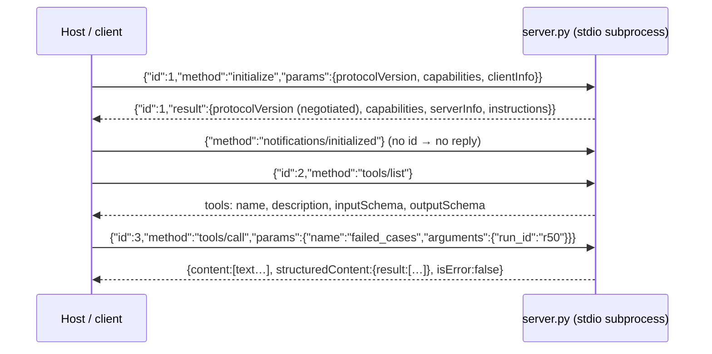

# 02 · MCP server basics: tools any agent can use

`🟢 Foundations` · `mcp`

> The two tools from 01, moved out of the app and into an MCP server, plus a client that speaks raw JSON-RPC so you can see exactly what goes over the wire.

## Problem
In 01 the tools live inside one script. A second app (Claude Code, a Slack bot, a LangGraph agent) would have to copy them, schemas included. MCP makes a tool a **service**: written once, discovered and called by any host through the same protocol.

## Pattern
**MCP server + clients at three levels of abstraction.**

| Piece | Shows |
|---|---|
| `server.py` | `@mcp.tool()` turns a typed function into a tool: `inputSchema` from type hints (`Literal` → `enum`), `description` from the docstring. `ToolError` for failures the model should read. One **resource** (`runs://{run_id}`) and one **prompt** (`triage_run`) for comparison. |
| `raw_client.py` | No MCP library: start the server, write JSON-RPC lines to stdin, read stdout. `initialize` → `notifications/initialized` → `tools/list` → `tools/call`. |
| `sdk_client.py` | The same session with the SDK `Client`, over stdio, HTTP or in-process. |

**Tools, resources, prompts:** the **model** chooses tools; the **app** chooses which resources to attach; the **user** picks prompts (in Claude Code they show up as slash commands).

## Architecture


What a `tools/call` result carries:
- `content`: text blocks, what most hosts put in front of the model.
- `structuredContent`: the same data as JSON, matching `outputSchema`, for code.
- `isError`: `true` when the tool failed. The message is in `content`, so the model can react ("Unknown run 'r99'. Call list_runs…").

Two details the raw client makes visible:
- The client proposes a protocol version and the **server answers with the one it supports**. A client must check that it can speak it.
- With stdio, **stdout is the protocol**. One stray `print()` in the server corrupts the stream, so logs go to stderr.

## Run
```bash
make test        # SDK client in-process + raw JSON-RPC over a real stdio subprocess (no keys, no AWS)
make raw         # watch every message of a session
make client      # the same with the SDK Client
make run-http    # serve on 127.0.0.1:9001/mcp; then: make client URL=http://127.0.0.1:9001/mcp
make inspect     # MCP Inspector UI
make claude      # register with Claude Code; then ask: "which payments runs failed and why?"
```

## Trade-offs
- **Gained:** tools are reusable across hosts and languages, discoverable at runtime, and testable without a model.
- **Gained:** stdio needs no network or auth; the same server also runs over HTTP as a shared service.
- **Cost:** a process boundary and a protocol to version. Tool descriptions are still prompt text, now shared by every agent that connects, so a bad description hurts all of them.
- **Next:** the production server, [`shared/mcp-server`](../../shared/mcp-server), adds DynamoDB, S3 reports, vector search over known issues and input validation. Projects 03–05 connect to it.
