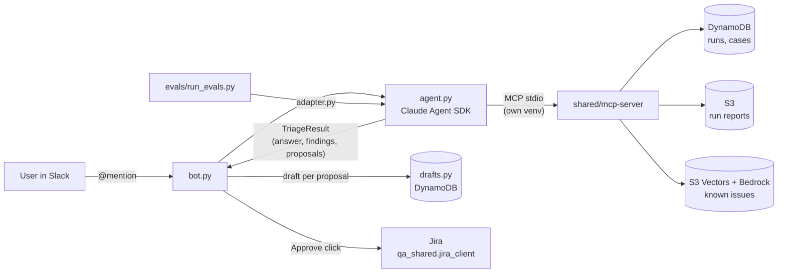

# 03 · QA triage with the Claude Agent SDK

`🟡 Intermediate` · `react` `mcp` `structured-output` `human-in-the-loop`

> A Slack bot that explains why nightly test runs failed, links each failure to a known issue (or says there is none), and drafts bugs that a person approves before anything reaches Jira.

## Problem
Every morning someone reads the failed nightly runs, opens logs, searches the known-issues list and decides what's new. Questions like *"Why did run r50 fail?"* or *"Which checkout tests keep failing?"* take minutes each, and the hard part is not the lookup: it's telling a real match from a similar-sounding one (a Safari login bug is not the Firefox one), and *not* filing duplicates.

A good answer cites the runs, gives each failing test a category (product bug, test bug, infra, flaky) and a known issue or an explicit "none", and proposes a bug only for what's genuinely new.

## Pattern
**ReAct loop with read-only tools and structured output.** The Agent SDK runs the loop: the model decides which tools to call and when it has enough evidence; the tools do the deterministic work (queries, type coercion, known-issue lookup, see [ADR 0003](../../docs/decisions/0003-deterministic-tools.md)).

| The model decides | Code decides |
|---|---|
| which runs and logs to look at | which tools exist (read-only allow-list, everything else denied) |
| whether a suggested known issue really matches | turn and budget limits (`max_turns=20`, `max_budget_usd=0.50`) |
| category, confidence, answer wording | the result shape (`output_format` = TriageOutput JSON schema, re-validated with pydantic) |
| whether a bug should be proposed | at most 3 proposals; filing in Jira only after an approver clicks |

## Architecture


| File | Role |
|---|---|
| `agent.py` | `triage(TriageRequest) -> TriageResult`: options, prompt, SDK stream → contract + trace |
| `bot.py` | Slack handlers: mention → answer + approval buttons; Approve/Skip → Jira or skip |
| `drafts.py` | pending proposals in DynamoDB; `claim()` is a conditional write, so a double click can't file twice |
| `adapter.py` | eval protocol: `--request req.json` → one `TriageResult` JSON on stdout |

## Run
```bash
make test                                  # offline: fake SDK stream, mocked DynamoDB, fake Slack
make ask Q="Why did run r50 fail?"         # one live question, prints the TriageResult
make run                                   # Slack bot (Socket Mode)
make eval REPEATS=3                        # shared eval cases -> evals/results/, docs/comparison.md
```
Live runs need: the data loaded (`make -C ../../shared seed-local reports kb`, DynamoDB Local running), the MCP server's venv (`make server`, done automatically by `ask`/`run`/`eval`), and either a Claude Code login or `ANTHROPIC_API_KEY`. Slack needs `SLACK_BOT_TOKEN`, `SLACK_APP_TOKEN` and scopes `app_mentions:read`, `chat:write`, `reactions:write`. Jira stays in dry-run (`DRYRUN-xxxxxx`) until `JIRA_*` is set. All variables: [`.env.example`](../../.env.example).

## Eval results
<!-- Copy this project's row from docs/comparison.md after `make eval`. -->
| Pass rate | Category acc. | KB match acc. | Median latency | Cost / run | Model |
|---|---|---|---|---|---|
| – | – | – | – | – | – |

## Trade-offs
- **Easy:** the loop, tool permissions, budgets and MCP wiring are configuration, not code. Cost and token usage come back on the result message, so the trace is free.
- **Easy:** structured output removes answer parsing; the eval adapter is ~20 lines.
- **Hidden:** the control flow lives in the model. The same question can take a different tool path on each run, which is why evals repeat every case and check the trajectory (`tools_must_include`).
- **Hidden:** the SDK drives the Claude Code CLI as a subprocess. Startup adds latency and the CLI must be available wherever this runs.
- **Production next steps:** run the MCP server over HTTP as a shared service, put the bot behind a queue so a slow answer can't block Slack retries, add tracing (OpenTelemetry) and an alert on cost per answer.
